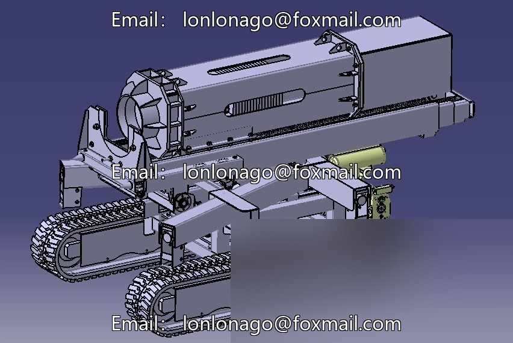
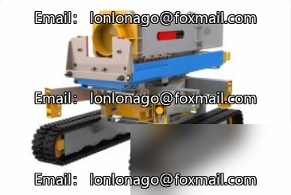
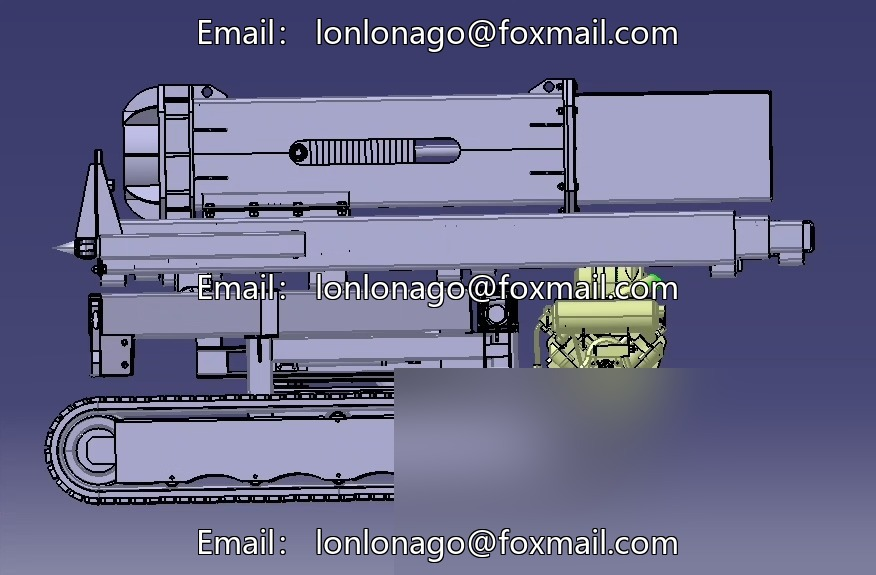
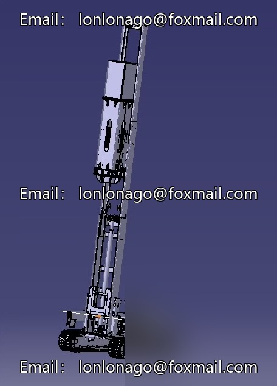

# Pile driver design drawings, pile driver model, pile driver 3D drawings, pile driver 3D figures

## Body

Pile driver design drawings, pile driver model, pile driver 3D drawings, pile driver 3D figures
98   Piling machine consists of pile hammer, pile frame, and auxiliary equipment. The pile hammer is attached to two parallel vertical guide rods at the front part of the pile frame.(Commonly known as Longmen)Between。
Specific reference to the attached figure

The drawings include a jack design, model, three-dimensional and 3D versions, indicating that the jack consists of a hammer, a pile socket and auxiliary equipment and is attached between two parallel vertical guide rods (commonly called a loader) at the front of the pile socket.

<!-- AI_ENRICHED -->

## Images

## Payment

Here is a pay link on Stripe ( https://buy.stripe.com/3cs8yP7sY87d0vu9AB ). Please contact me lonlonago@foxmail.com after funding $89, and I will send you a complete data files , thank you!

